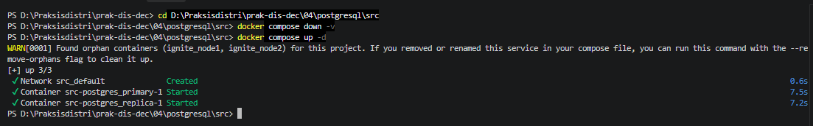

# Laporan Praktikum Modul 4 — Konsistensi dan Replikasi pada Sistem Terdistribusi

| | |
|---|---|
| **Nama** | _Laesah Afenlia_ |
| **NIM** | _255410019_ |
| **Mata Kuliah** | Sistem Terdistribusi dan Terdesentralisasi |
| **Prodi** | Informatika |

Repo ini berisi hasil praktikum dua model replikasi:

1. **Streaming Replication PostgreSQL 18** (primary → replica, asinkron)
2. **Replikasi Master-Master dengan Apache Ignite 3.1.0** (cluster 3 node)

## Struktur Repo

```
.
├── README.md
├── postgresql/
│   └── src/
│       ├── 00_init.sql
│       ├── docker-compose.yaml
│       ├── env.sh
│       └── img/            <- screenshot bukti
└── ignite/
    └── src/
        ├── docker-compose.yaml
        ├── env.sh
        ├── sql/            <- schema.sql, current_catalog.sql, dst.
        └── img/            <- screenshot bukti
```

---

# Bagian 1 — Streaming Replication PostgreSQL 18

## 1.1 Konsep Singkat

*Streaming replication* mengirimkan **WAL (Write-Ahead Log)** dari server **primary** ke server **standby/replica** secara terus-menerus lewat koneksi TCP. Replica memutar ulang (*replay*) WAL tersebut sehingga datanya identik dengan primary.

- **Primary**: menerima operasi *read-write*.
- **Replica (hot standby)**: hanya *read-only*, selalu menyinkronkan diri dari primary.
- **Mode**: asinkron (`sync_state = async`). Primary tidak menunggu konfirmasi replica sebelum commit, sehingga cepat, tetapi ada kemungkinan kecil replica tertinggal (*replication lag*).
- **Replication slot**: menjamin primary tidak menghapus WAL yang belum diterima replica.

## 1.2 Penjelasan File

### `00_init.sql`
Dijalankan otomatis saat primary pertama kali diinisialisasi (karena di-mount ke `/docker-entrypoint-initdb.d/`).

```sql
CREATE USER replicator WITH REPLICATION ENCRYPTED PASSWORD 'replicator_password';
SELECT pg_create_physical_replication_slot('replication_slot');
```

- Baris 1: membuat user `replicator` yang punya hak `REPLICATION`, dipakai replica untuk menarik WAL.
- Baris 2: membuat *physical replication slot* bernama `replication_slot`.

### `docker-compose.yaml`

| Bagian | Fungsi |
|---|---|
| `x-postgres-common` | Template bersama (YAML anchor) untuk kedua service: image `postgres:18.3-alpine3.23`, user `postgres`, `restart: always`, dan *healthcheck* `pg_isready`. |
| `postgres_primary` | Port `5432`. User/DB/password: `zuser`/`zdb`/`zpass`. |
| `POSTGRES_HOST_AUTH_METHOD` | Mengatur `pg_hba.conf`: metode `scram-sha-256` untuk koneksi biasa, serta baris `host replication replicator 0.0.0.0/0 md5` agar user `replicator` boleh melakukan replikasi. |
| `command` (primary) | `wal_level=replica`, `hot_standby=on`, `max_wal_senders=10`, `max_replication_slots=10`, `hot_standby_feedback=on`. |
| `postgres_replica` | Port host `5433` → `5432` container. Memakai `PGUSER=replicator`. `PGDATA=/var/lib/postgresql/18/docker` (lokasi data PG 18 berbeda dari versi lama). |
| `command` (replica) | Menjalankan `pg_basebackup -R --slot=replication_slot -X stream` ke `postgres_primary` (diulang tiap 5 detik sampai berhasil), `chmod 0700` pada direktori data, lalu menjalankan `postgres`. Opsi `-R` otomatis membuat `standby.signal` dan `primary_conninfo`. |
| `depends_on` | Replica dijalankan setelah primary. |

### `env.sh`
Kumpulan alias agar perintah lebih singkat (opsional):

| Alias | Perintah |
|---|---|
| `dcu` | `sudo docker-compose up -d` |
| `dcd` | `sudo docker-compose down` |
| `dps` | `sudo docker ps` |
| `dep` / `der` | masuk bash ke container primary / replica |
| `dlp` / `dlr` | lihat log primary / replica |

> Nama container diawali nama direktori. Karena file disimpan di direktori `src`, namanya `src-postgres_primary-1` dan `src-postgres_replica-1`. **Jika direktori kamu bernama lain, sesuaikan `env.sh`.**

## 1.3 Langkah Menjalankan

```bash
cd postgresql/src
source env.sh
dcu          # docker-compose up -d
dps          # cek STATUS harus (healthy)
```

Jika STATUS belum `healthy`, cek log:

```bash
dlp   # log primary
dlr   # log replica
```

Log replica yang normal memuat pesan `Backup done, starting replica...` dan `started streaming WAL from primary`. Pesan `pg_basebackup failed. Retrying...` di awal itu wajar (primary belum siap).

📸 **Bukti:** `img/pg-01-dcu.png`, `img/pg-02-dps-healthy.png`, `img/pg-03-log-replica.png`




## 1.4 Pengujian Replikasi

### a. Cek status replikasi di primary

```bash
dep
psql -U zuser -d zdb
```
```sql
\x
SELECT * FROM pg_stat_replication;
SELECT * FROM pg_replication_slots;
```

Yang diperhatikan:
- `pg_stat_replication`: `usename = replicator`, `state = streaming`, `sync_state = async`, dan `sent_lsn/write_lsn/flush_lsn/replay_lsn` bernilai sama (tidak ada lag).
- `pg_replication_slots`: `slot_name = replication_slot`, `slot_type = physical`, `active = t`.

📸 `img/pg-04-stat-replication.png`, `img/pg-05-replication-slots.png`

### b. Cek di replica

```bash
der
psql -U zuser -d zdb
```
```sql
SELECT pg_is_in_recovery();
```
Hasil `t` (true) berarti server tersebut adalah standby/replica.

📸 `img/pg-06-replica-in-recovery.png`

### c. Uji manipulasi data

**Sebelum membuat tabel** — jalankan `\dt` di primary dan replica, keduanya `Did not find any tables.`

📸 `img/pg-07-dt-primary-before.png`, `img/pg-08-dt-replica-before.png`

**Di primary:**
```sql
CREATE TABLE testrep (first INT, second VARCHAR(15));
INSERT INTO testrep (first, second) VALUES (21, 'Test pertama');
INSERT INTO testrep (first, second) VALUES (23, 'Test ke dua');
SELECT * FROM testrep;
```

📸 `img/pg-09-primary-insert.png`

**Di replica:**
```sql
\dt
SELECT * FROM testrep;
```
Tabel `testrep` beserta 2 baris datanya muncul otomatis di replica tanpa operasi apa pun, ini membuktikan replikasi berjalan.

📸 `img/pg-10-replica-select.png`

> Coba juga `INSERT` langsung di replica. Akan gagal dengan error `cannot execute INSERT in a read-only transaction`, karena replica hanya *read-only*.

## 1.5 High Availability (Failover)

Jika primary mati, replica bisa **dipromosikan** menjadi primary.

**1. Matikan primary:**
```bash
sudo docker-compose stop postgres_primary
```
📸 `img/pg-11-stop-primary.png`

**2. Promosikan replica** (masuk ke psql di replica):
```sql
SELECT pg_is_in_recovery();   -- t (masih replica)
SELECT pg_promote();          -- t (berhasil dipromosikan)
SELECT pg_is_in_recovery();   -- f (sekarang primary, bisa read-write)
```
📸 `img/pg-12-pg-promote.png`

Setelah dipromosikan, node tersebut keluar dari mode recovery dan menerima operasi tulis.

> **Catatan:** `pg_promote()` bersifat manual. Untuk produksi biasanya dipakai tool otomatis seperti Patroni atau repmgr. Selain itu, primary lama tidak otomatis kembali jadi replica; harus di-*rebuild* dengan `pg_basebackup` atau `pg_rewind`.

**3. Matikan semuanya:**
```bash
dcd
dps
```
📸 `img/pg-13-dcd.png`

---

# Bagian 2 — Replikasi Master-Master dengan Apache Ignite 3.1.0

## 2.1 Konsep Singkat

Apache Ignite 3 membentuk **cluster** dari beberapa node. Data didistribusikan dan direplikasi antar node menggunakan protokol konsensus **Raft**. Dari sudut pandang pengguna, koneksi ke node mana pun bisa dipakai untuk membaca dan menulis, sehingga sering disebut replikasi "Master-Master". Perubahan yang dilakukan di satu node otomatis terlihat di node lain.

> Secara teknis, di balik layar tiap partisi data punya satu *leader* Raft yang memproses tulis, tetapi klien tidak perlu peduli node mana pemimpinnya karena request diteruskan otomatis.

## 2.2 Penjelasan File

### `docker-compose.yaml`
- Menjalankan **3 node** (`node1`, `node2`, `node3`) dari image `apacheignite/ignite:3.1.0`.
- `JVM_MAX_MEM` / `JVM_MIN_MEM` = `4g` per node.
- Konfigurasi jaringan lewat `configs`: port klaster `3344` dan `nodeFinder` berisi ketiga node agar saling menemukan.
- Pemetaan port:

| Node | REST API (admin/CLI) | Koneksi aplikasi |
|---|---|---|
| node1 | `10300` | `10800` |
| node2 | `10301` | `10801` |
| node3 | `10302` | `10802` |

### `env.sh`

| Alias | Fungsi |
|---|---|
| `dcu` / `dcd` / `dps` | up, down, daftar container |
| `dcli` | menjalankan Ignite CLI di container |
| `dclm` | sama seperti `dcli` tetapi me-*mount* `./sql` ke `/opt/ignite/sql` agar file SQL bisa dieksekusi |

### Folder `sql/`
`schema.sql`, `current_catalog.sql`, `media_and_genre.sql`, `tracks.sql`, `ee_and_cust.sql`, `invoices.sql`: skema dan data contoh (database musik *Chinook*).

## 2.3 Menjalankan Cluster

```bash
cd ignite/src
source env.sh
dcu
dps
```

Cek alamat IP tiap node:
```bash
sudo docker inspect -f '{{range .NetworkSettings.Networks}}{{.IPAddress}}{{end}}' <CONTAINER_ID>
ping <IP>
```

📸 `img/ig-01-dcu.png`, `img/ig-02-dps.png`, `img/ig-03-ip-ping.png`

## 2.4 Inisialisasi Cluster

```bash
dcli
```
Pilih `Y` saat ditanya konek ke `http://localhost:10300`, lalu:
```
cluster init --name=ignite3 --metastorage-group=node1,node2,node3
cluster status
```
Hasil yang diharapkan: `status: active`, `nodes: 3`.

- `--metastorage-group` dan CMG: node-node yang menyimpan metadata cluster. Semua 3 node dilibatkan supaya tahan jika 1 node mati.
- Inisialisasi hanya dilakukan **sekali**. Jika keluar CLI (Ctrl-D) lalu masuk lagi, tidak perlu init ulang.

📸 `img/ig-04-cluster-init.png`

## 2.5 Eksekusi SQL

Gunakan `dclm` (karena butuh mount `./sql`), konek ke `http://localhost:10300` (node1):

```
sql --file=/opt/ignite/sql/schema.sql
sql --file=/opt/ignite/sql/current_catalog.sql
sql --file=/opt/ignite/sql/media_and_genre.sql
sql --file=/opt/ignite/sql/tracks.sql
sql --file=/opt/ignite/sql/ee_and_cust.sql
sql --file=/opt/ignite/sql/invoices.sql
```

Lihat tabel yang terbentuk:
```
sql
SELECT * FROM system.tables WHERE schema = 'PUBLIC';
```

📸 `img/ig-05-schema.png`, `img/ig-06-system-tables.png`, `img/ig-07-load-data.png`

## 2.6 Verifikasi Replikasi di Node Lain

Dari CLI, pindah ke node2:
```
connect http://localhost:10301
sql
SELECT * FROM system.tables WHERE schema = 'PUBLIC';
```
Lalu jalankan query analitik (ringkasan penjualan bulanan):

```sql
SELECT
    CAST(EXTRACT(YEAR FROM i.InvoiceDate) AS VARCHAR) || '-' ||
    CASE
        WHEN EXTRACT(MONTH FROM i.InvoiceDate) < 10
        THEN '0' || CAST(EXTRACT(MONTH FROM i.InvoiceDate) AS VARCHAR)
        ELSE CAST(EXTRACT(MONTH FROM i.InvoiceDate) AS VARCHAR)
    END AS YearMonth,
    COUNT(DISTINCT i.InvoiceId) AS InvoiceCount,
    COUNT(DISTINCT i.CustomerId) AS CustomerCount,
    SUM(i.Total) AS MonthlyRevenue,
    AVG(i.Total) AS AverageOrderValue
FROM Invoice i
GROUP BY EXTRACT(YEAR FROM i.InvoiceDate), EXTRACT(MONTH FROM i.InvoiceDate)
ORDER BY YearMonth DESC;
```

Ulangi untuk node3 (`connect http://localhost:10302`).

📸 `img/ig-08-node2-tables.png`, `img/ig-09-node2-query.png`, `img/ig-10-node3-query.png`

**Analisis:** data dimasukkan hanya lewat node1, tetapi node2 dan node3 menghasilkan data dan hasil query yang sama persis. Artinya data sudah direplikasi ke seluruh node dalam cluster, sehingga replikasi Master-Master berhasil.

Matikan semua node:
```bash
dcd
```
📸 `img/ig-11-dcd.png`

---

# Perbandingan Kedua Model

| Aspek | PostgreSQL Streaming Replication | Apache Ignite 3 |
|---|---|---|
| Topologi | Single-primary, banyak replica | Cluster multi-node |
| Tulis | Hanya di primary | Bisa lewat node mana pun |
| Replica | Read-only (hot standby) | Semua node setara bagi klien |
| Mekanisme | Pengiriman WAL (asinkron) | Konsensus Raft |
| Failover | Manual (`pg_promote()`) / tool eksternal | Otomatis (pemilihan leader Raft) selama mayoritas node hidup |
| Konsistensi | *Eventual* (ada lag kecil pada mode async) | Konsisten kuat per partisi |

# Kesimpulan

1. Streaming replication PostgreSQL berhasil: tabel dan data yang dibuat di primary muncul otomatis di replica, dan replica dapat dipromosikan menjadi primary saat primary mati (HA).
2. Cluster Apache Ignite 3.1.0 dengan 3 node berhasil diinisialisasi, dan data yang dimasukkan lewat satu node dapat dibaca dari node lain.
3. Kedua pendekatan memberi *availability* yang lebih baik daripada server tunggal. Pilihannya bergantung pada kebutuhan: PostgreSQL cocok untuk arsitektur read-replica yang sederhana, Ignite cocok jika dibutuhkan cluster terdistribusi tanpa satu titik tulis tunggal.

# Referensi

- Modul 4 Praktikum Sistem Terdistribusi dan Terdesentralisasi (Dr. Bambang Purnomosidi D. P.)
- https://medium.com/@eremeykin/how-to-setup-single-primary-postgresql-replication-with-docker-compose-98c48f233bbf
- https://www.postgresql.org/docs/current/warm-standby.html
- https://ignite.apache.org/docs/ignite3/latest/
