# LAPORAN PRAKTIKUM SISTEM TERDISTRIBUSI DAN TERDESENTRALISASI

## Modul 5 — Fault Tolerance: Load Balancing Aplikasi dan Failure Detection
---
Nama = Laesah Afenlia 
NIM = 255410019 
Kelas = IF 1 
---

## 1. Tujuan Praktikum

1. Memahami konsep *fault tolerance* dan *high availability* pada sistem terdistribusi.
2. Membuat aplikasi web berbasis ASGI Python menggunakan framework BlackSheep.
3. Melakukan *scaling* aplikasi menjadi lebih dari satu *instance* (2 instance) menggunakan Docker Compose.
4. Mengkonfigurasi nginx sebagai *reverse proxy* sekaligus *load balancer*.
5. Memahami dan mempraktikkan mekanisme *failure detection* menggunakan protokol *heartbeat*.
6. Memahami penerapan pola *retry* (library `tenacity`) dan pola *circuit breaker* untuk menangani kegagalan koneksi ke komponen eksternal.

---

## 2. Dasar Teori

### 2.1 Fault Tolerance
*Fault tolerance* (toleransi kesalahan) adalah kemampuan sistem untuk tetap berfungsi dengan benar meskipun sebagian komponennya mengalami kegagalan. Pada sistem terdistribusi, kegagalan adalah hal yang wajar (node mati, jaringan putus, proses *crash*), sehingga sistem harus dirancang agar kegagalan satu komponen tidak membuat seluruh layanan berhenti. Teknik yang umum digunakan antara lain replikasi (redundansi), *load balancing*, *failure detection*, *retry*, dan *circuit breaker*.

### 2.2 High Availability dan Scaling
*High availability* (HA) adalah kondisi ketika layanan tetap tersedia dalam waktu yang sangat tinggi. Salah satu cara mencapainya adalah *horizontal scaling*, yaitu menjalankan aplikasi lebih dari satu *instance*. Jika satu instance gagal, instance lain masih dapat melayani permintaan.

### 2.3 Load Balancing
*Load balancing* adalah teknik mendistribusikan permintaan (*request*) dari klien ke beberapa server/instance agar beban terbagi merata, waktu respons lebih baik, dan tidak ada *single point of failure* pada sisi aplikasi. Algoritma yang umum: *round robin*, *least connections*, dan *IP hash*. Pada nginx, algoritma bawaan untuk blok `upstream` adalah *round robin*.

### 2.4 nginx sebagai Reverse Proxy
nginx adalah web server yang juga banyak dipakai sebagai *reverse proxy* dan *load balancer*. Direktif `upstream` mendefinisikan kelompok server *backend*, sedangkan `proxy_pass` meneruskan permintaan klien ke kelompok tersebut. Klien hanya berkomunikasi dengan nginx (port 80), tanpa mengetahui ada berapa instance di belakangnya.

### 2.5 Docker dan Docker Compose
*Docker* membungkus aplikasi beserta dependensinya ke dalam *container* sehingga lingkungan eksekusi konsisten. *Docker Compose* memungkinkan pengelolaan beberapa container sekaligus melalui satu berkas `docker-compose.yml`. Opsi `--scale <service>=N` digunakan untuk menjalankan N instance dari suatu *service*. Di dalam jaringan Compose, container dapat saling menjangkau menggunakan nama *service* (misalnya `bs_app`) sebagai nama host.

### 2.6 BlackSheep
BlackSheep adalah *web framework* asinkron untuk Python yang berjalan di atas standar ASGI (dijalankan dengan server seperti Uvicorn). Pada praktikum ini BlackSheep hanya digunakan sebagai aplikasi contoh (template `mvc`) untuk keperluan pengujian *load balancing*.

### 2.7 Failure Detection
*Failure detection* adalah proses untuk menentukan apakah suatu komponen telah gagal. Deteksi yang akurat penting agar sistem dapat segera melakukan pemulihan, misalnya mengalihkan lalu lintas ke komponen lain.

### 2.8 Heartbeat
Protokol *heartbeat* memantau aktivitas suatu komponen. Jika komponen pemantau tidak menerima *heartbeat* dari komponen lain dalam jangka waktu tertentu, komponen tersebut diasumsikan telah gagal dan tidak responsif. Pada praktikum ini, pemeriksaan dilakukan dengan script `check-server.py` yang mencoba terhubung ke host dan port tertentu.

### 2.9 Retry dengan Tenacity
Koneksi ke komponen di luar aplikasi selalu berpotensi gagal (kegagalan sementara/*transient*). Pola *retry* mengulangi percobaan beberapa kali sebelum menyerah. Library `tenacity` menyediakan dekorator untuk mengatur jumlah percobaan, jeda antar percobaan (*wait*), dan kondisi berhenti (*stop*).

### 2.10 Circuit Breaker
*Circuit breaker* adalah pola desain pada *microservices* untuk mencegah kegagalan berantai (*cascading failure*) dengan memblokir sementara panggilan ke layanan yang gagal. Pola ini bekerja sebagai *state machine* dengan tiga status:


---

## 3. Langkah Kerja

### 3.1 Persiapan Environment

```bash
mkdir workspace-05
cd workspace-05
uv venv
source .venv/bin/activate
uv pip install blacksheep blacksheep-cli
```
**uv pip install blacksheep**<br>
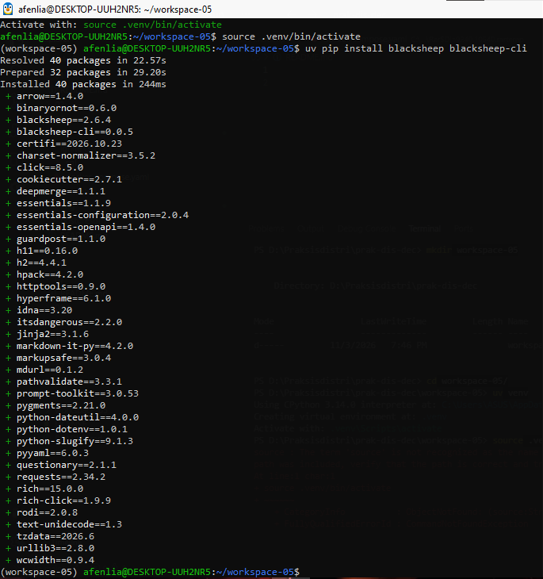<br>

**uv pip install blacksheep-cli**<br>
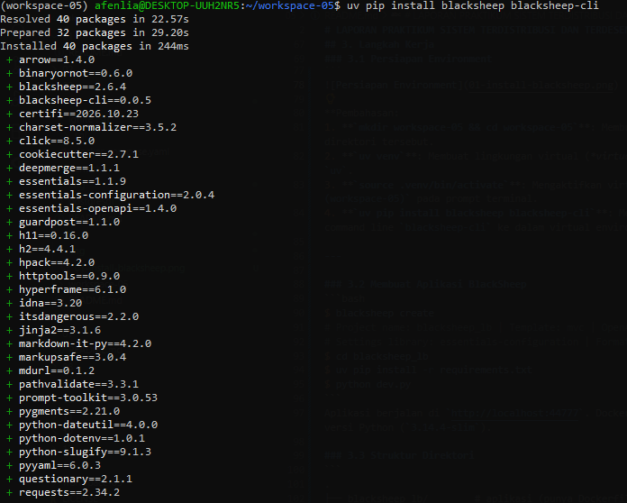<br>

**Pembahasan:**
1. **`mkdir workspace-05 && cd workspace-05`**: Membuat direktori kerja baru bernama `workspace-05` dan langsung berpindah ke dalam direktori tersebut.
2. **`uv venv`**: Membuat lingkungan virtual (*virtual environment*) Python terisolasi di dalam direktori `.venv` menggunakan tool `uv`.
3. **`source .venv/bin/activate`**: Mengaktifkan virtual environment yang telah dibuat, ditandai dengan munculnya nama environment `(workspace-05)` pada prompt terminal.
4. **`uv pip install blacksheep blacksheep-cli`**: Mengunduh dan menginstal framework web berbasis ASGI `blacksheep` beserta perkakas command line `blacksheep-cli` ke dalam virtual environment.

---

### 3.2 Membuat Aplikasi BlackSheep
2. Pembuatan Aplikasi Web
Setelah itu, buat aplikasi menggunakan cli:<br>
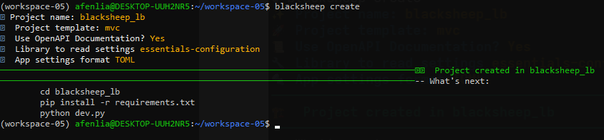<br>

```bash
$ blacksheep create
# Project name: blacksheep_lb | Template: mvc | OpenAPI: Yes
# Settings library: essentials-configuration | Format: TOML
$ cd blacksheep_lb
$ uv pip install -r requirements.txt
$ python dev.py
```

**Pembahasan:**
1. **`blacksheep create`**: Men-generate struktur awal project aplikasi web secara otomatis dengan template MVC dan fitur OpenAPI.
2. **`cd blacksheep_lb`**: Masuk ke dalam direktori project `blacksheep_lb` yang baru saja dibuat.
3. **`uv pip install -r requirements.txt`**: Mengunduh dan menginstal seluruh pustaka dependensi yang dibutuhkan oleh aplikasi ke dalam virtual environment.
4. **`python dev.py`**: Menjalankan server lokal (Uvicorn) untuk pengujian awal pada port `44777`. Catatan: Pada Dockerfile bawaan project, port bawaan yang digunakan untuk container adalah port `80`.


Pada tahap ini, dibuat kerangka aplikasi web berbasis ASGI menggunakan perkakas `blacksheep-cli` dengan arsitektur MVC (Model-View-Controller):<br>
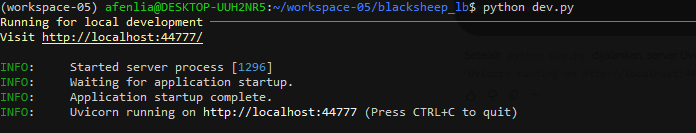<br>

**Pembahasan:**

1. **`python dev.py`**: Perintah ini dijalankan di dalam folder project `blacksheep_lb` untuk menyalakan server lokal pengembang berbasis kerangka kerja ASGI Uvicorn.
2. **Log Berhasil (`Uvicorn running on http://localhost:44777`)**: Menandakan bahwa proses inisialisasi aplikasi web BlackSheep telah sukses, server siap berjalan, dan dapat diakses melalui browser pada port `44777`.


Pastikan bahwa aplikasi tersebut bisa berjalan dengan baik:<br>
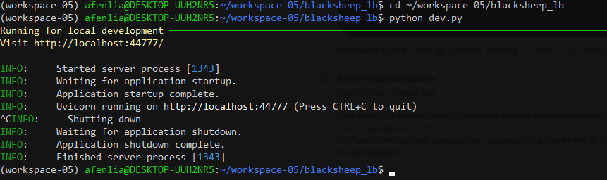<br>

**Pembahasan:**

1. **`python dev.py`**: Perintah ini dijalankan di dalam direktori `blacksheep_lb` untuk menyalakan server lokal pengembang (*development server*) berbasis ASGI Uvicorn.
2. **Log Uvicorn**: Pesan `Uvicorn running on http://localhost:44777` menunjukkan bahwa aplikasi telah berhasil dijalankan dan siap diuji coba melalui browser.
3. **`^C` (Shutting Down)**: Menandakan proses server dihentikan sementara dengan menekan kombinasi tombol `Ctrl + C` pada terminal setelah pengujian selesai.

Akses ke http://localhost:44777 menggunakan browser:<br>

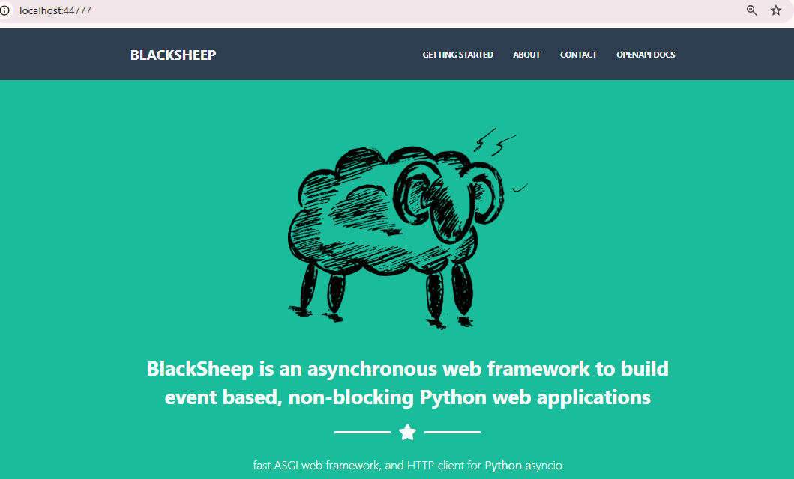<br>

**Pembahasan:**

**Akses Web Browser**: Saat alamat `http://localhost:44777` dibuka melalui web browser, aplikasi berhasil merender halaman utama berlatar hijau yang menandakan kerangka web framework ASGI BlackSheep berjalan dengan normal dan siap digunakan.

Pada shell tempat kita mengaktifkan server, muncul:
Pada shell/terminal tempat server dijalankan, muncul log HTTP request:<br>

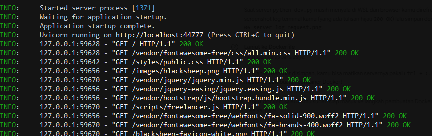<br>

**Pembahasan:**
1. **HTTP GET Log**: Kemunculan status `200 OK` pada log terminal menandakan bahwa server aplikasi berhasil merespons dan mengirimkan halaman utama serta file-file statis (seperti CSS, JavaScript, dan gambar) ke browser pengguna tanpa kendala.
2. **Kesiapan Containerization**: Sampai tahap ini, pembuatan aplikasi web BlackSheep secara lokal telah selesai dan struktur direktori `blacksheep_lb` sudah siap untuk masuk ke proses pembentukan citra Docker (*Docker image*) menggunakan `Dockerfile` bawaan.


Pada titik ini, aplikasi web menggunakan BlackSheep telah berhasil dibuat. Ketika diperiksa, di dalam direktori `blacksheep_lb` sudah terdapat file `Dockerfile` bawaan.<br>

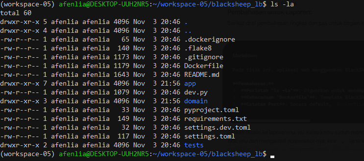<br>

**Pembahasan:**
1. **Perintah `ls -la`**: Digunakan untuk menampilkan seluruh daftar berkas dan direktori (termasuk berkas tersembunyi) secara detail di dalam folder project `blacksheep_lb`.
2. **Keberadaan `Dockerfile`**: Template BlackSheep secara otomatis menyediakan berkas `Dockerfile` dan `.dockerignore` untuk keperluan kontainerisasi aplikasi.
3. **Catatan Port**: Secara default, `Dockerfile` bawaan BlackSheep membuka **port 80**, bukan port `44777` seperti pada saat pengembangan lokal. Hal ini penting untuk diperhatikan dan disesuaikan nantinya saat menggunakan Docker Compose.

### 3.3 	Siapkan Dockerfile dan docker-compose.yml 
*Langkah 1: Membuat Struktur Folder Nginx & Docker-compose*

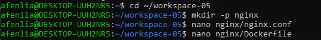<br>

**Pembahasan:**
1. **Navigasi Direktori (`cd ~/workspace-05`)**: Berpindah ke direktori kerja utama workspace agar seluruh pengelolaan kontainer dan layanan proxy terpusat dengan rapi.
2. **Pembuatan Direktori Nginx (`mkdir -p nginx`)**: Membuat folder khusus `nginx` yang akan menampung file konfigurasi proxy dan Dockerfile tersendiri.
3. **Inisialisasi Berkas Konfigurasi**: Menyiapkan berkas `nginx.conf` serta `Dockerfile` di dalam direktori `nginx` untuk mengatur mekanisme *load balancing* pada arsitektur terdistribusi.


**Langkah 2: Membuat Berkas Konfigurasi Nginx**
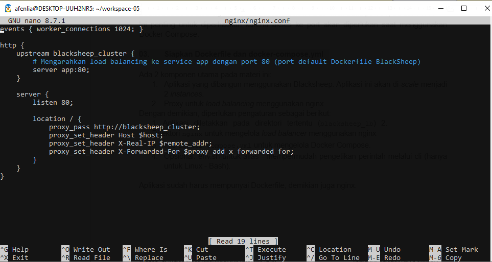<br>

**Pembahasan:**
1. **Upstream Cluster**: Blok `upstream blacksheep_cluster` digunakan untuk mendefinisikan grup server aplikasi (`server app:80`) yang akan menerima pendistribusian beban kerja (*load balancing*).
2. **Reverse Proxy Configuration**: Blok `server` pada port 80 berfungsi mendengarkan permintaan masuk (*incoming requests*) lalu meneruskannya via `proxy_pass` ke kelompok server `blacksheep_cluster`.
3. **HTTP Header Forwarding**: Pengaturan `proxy_set_header` memastikan informasi penting klien (seperti *Host*, *IP Real*, dan *Forwarded Header*) tetap diteruskan dari Nginx ke aplikasi BlackSheep di dalam kontainer.


**Langkah 3: Membuat Dockerfile untuk Nginx (nginx/Dockerfile)**
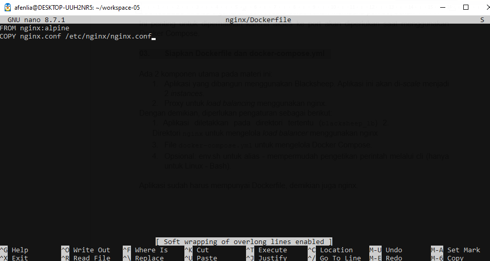<br>

**Pembahasan:**
1. **Pembuatan `nginx/Dockerfile`**: Berkas ini dibuat di dalam direktori `nginx` untuk menyiapkan kontainer *reverse proxy* menggunakan *base image* ringan berbasis Alpine (`nginx:alpine`).
2. **Perintah `COPY`**: Baris perintah `COPY nginx.conf /etc/nginx/nginx.conf` berfungsi untuk menyalin konfigurasi load balancer kustom ke dalam direktori konfigurasi bawaan Nginx di dalam kontainer.

**Langkah 4: Membuat File docker-compose.yml di Root Workspace**
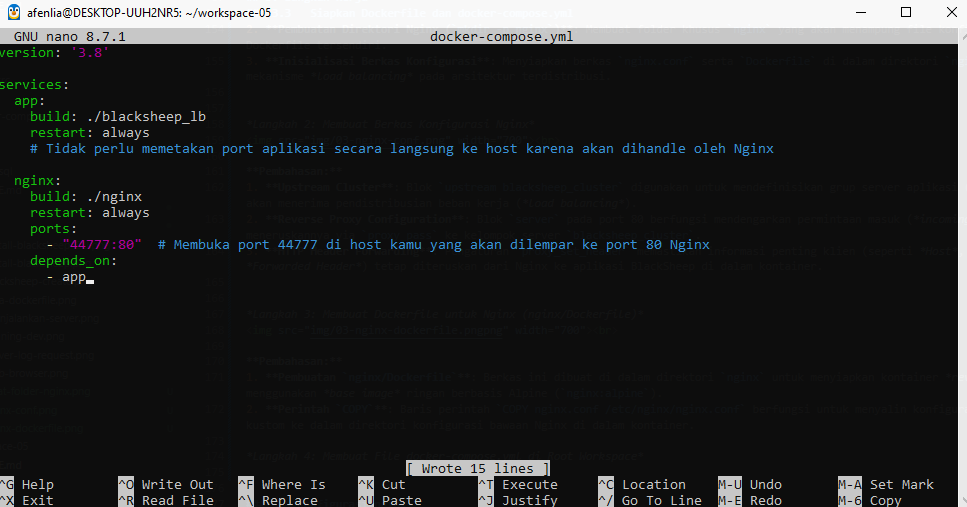<br>

**Pembahasan:**
1. **Layanan `app`**: Menjalankan kontainer aplikasi BlackSheep dengan mengompilasi kode dari direktori `./blacksheep_lb`.
2. **Layanan `nginx`**: Menjalankan kontainer Nginx sebagai *reverse proxy* dan memetakan port `44777` di mesin host ke port `80` pada kontainer.
3. **`depends_on`**: Memastikan layanan Nginx baru akan berjalan setelah kontainer aplikasi (`app`) siap.

**blacksheep_lb/Dockerfile**<br>

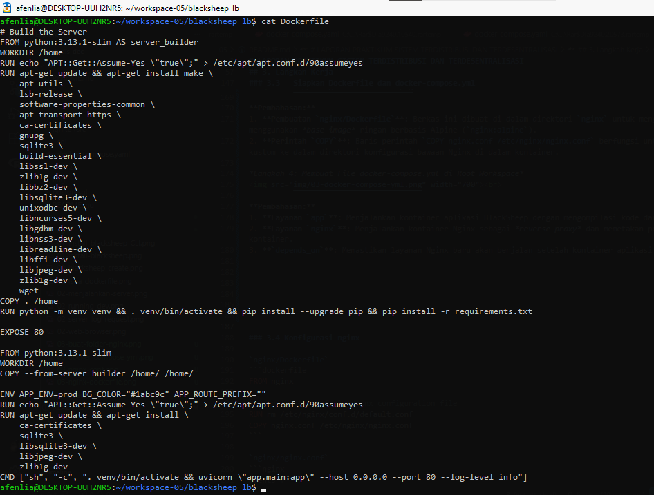<br>

**Pembahasan:**
1. **Perintah `cat Dockerfile`**: Digunakan untuk menampilkan keseluruhan isi teks dari berkas `Dockerfile` di dalam direktori `blacksheep_lb` secara langsung pada terminal.
2. **Multi-Stage Build**: Konfigurasi kontainer dibagi menjadi dua tahap (menggunakan `AS server_builder` dan base image slim) untuk memastikan dependensi instalasi yang besar terpisah dari lingkungan runtime utama, sehingga ukuran image akhir lebih efisien.
3. **Eksekusi Aplikasi**: Mengatur lingkungan virtual Python, membuka port `80`, serta menjalankan server Uvicorn secara otomatis melalui perintah `CMD` saat kontainer diaktifkan. 

## 1. Stage 1: Build Environment (server_builder)
* **Base Image**: Menggunakan `python:3.14.4-slim` sebagai dasar untuk merakit aplikasi dan diberi nama *stage* `server_builder`.
* **Instalasi Pustaka Sistem**: Mengunduh dan menginstal dependensi tingkat sistem (seperti `build-essential`, `libssl-dev`, `sqlite3`, dll.) yang dibutuhkan untuk kompilasi paket Python.
* **Menyiapkan Lingkungan Virtual**: Menyalin kode sumber ke folder `/home`, membuat *virtual environment* (`venv`), serta menginstal dependensi Python dari file `requirements.txt`.

## 2. Stage 2: Production Environment (Final Image)
* **Base Image Bersih**: Menggunakan *base image* `python:3.14.4-slim` baru yang terpisah dari *stage* pertama untuk menjaga ukuran citra (*image*) tetap efisien.
* **Penyalinan Hasil Build**: Hanya menyalin direktori `/home` yang sudah berisi lingkungan virtual dan pustaka siap pakai dari *stage* `server_builder`. Alat-alat kompilasi yang berat tidak ikut tersalin.
* **Variabel Lingkungan & Port**: Mengatur *environment variable* (`APP_ENV=prod`, `BG_COLOR="#1abc9c"`) serta membuka jalur komunikasi *port* `80` lewat instruksi `EXPOSE 80`.
* **Perintah Eksekusi**: Menjalankan server ASGI Uvicorn via `CMD` untuk mengaktifkan aplikasi web BlackSheep secara otomatis saat kontainer berjalan.

**env.sh**<br>
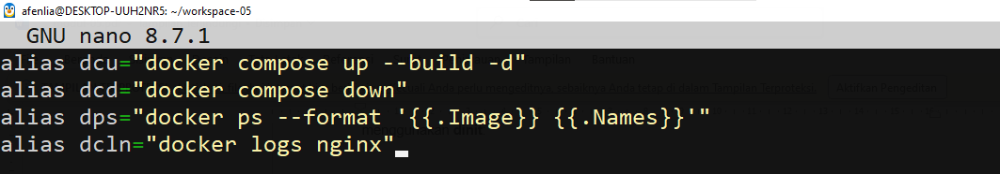<br>


### 3.4 Konfigurasi nginx

`nginx/Dockerfile`
```
dockerfile
FROM nginx

# Override the default nginx configuration file
RUN rm /etc/nginx/conf.d/default.conf
COPY nginx.conf /etc/nginx/nginx.conf
```

`nginx/nginx.conf`
```nginx
events {
  worker_connections 4096;
}

http {
  # Definisi grup, lihat di docker-compose.yml
  upstream backend {
    server bs_app:80;
  }
  server {
    listen 80;
    location / {
      # sesuaikan dengan nama upstream di atas
      proxy_pass http://backend;
    }
  }
}
```

### 3.5 docker-compose.yml
```yaml
services:
  # aplikasi yang akan di-scale, ada pada direktori blacksheep_lb
  bs_app:
    build: ./blacksheep_lb
  # nginx dibangun dari nginx/Dockerfile
  nginx:
    container_name: nginx
    build: ./nginx
    ports:
      - 80:80
    depends_on:
      - bs_app
```

### 3.6 Alias (env.sh)
```bash
alias dcu="sudo docker-compose up --build -d --scale bs_app=2"
alias dcd="sudo docker compose down"
alias dps="docker ps --format '{{.Image}} {{.Names}}'"
alias dcln="docker logs nginx"
```

### 3.7 Menjalankan Sistem
```bash
$ sudo dinitctl start dockerd     # Systemd: sudo systemctl start docker
$ source env.sh
$ dcu                             # build + jalankan, bs_app di-scale jadi 2
$ dps                             # cek container
$ sudo docker logs load-balancing-bs_app-1
$ sudo docker logs load-balancing-bs_app-2
$ dcd                             # matikan semua container
```

### 3.8 Pengujian Failure Detection
```bash
# Heartbeat
$ python check-server.py localhost 44777
$ python check-server.py localhost 80

# Retry (tenacity)
$ python check-retry.py

# Circuit breaker
$ python check-circuit-breaker.py
```
Masing-masing script dijalankan pada dua kondisi: aplikasi BlackSheep **aktif** dan **non-aktif** di port 44777.

---

## 4. Hasil dan Pembahasan

### 4.1 Load Balancing
Setelah `dcu`, Docker membangun image `bs_app` dan `nginx`, lalu menjalankan 3 container. Perintah `dps` menampilkan:

```
load-balancing-nginx nginx
load-balancing-bs_app load-balancing-bs_app-1
load-balancing-bs_app load-balancing-bs_app-2
```

Awalan `load-balancing` berasal dari nama direktori proyek. Aplikasi dapat diakses melalui `http://localhost` (port 80), bukan lagi port 44777, karena klien sekarang berkomunikasi dengan nginx.

Pada log kedua instance terlihat permintaan `GET /` beserta aset statis (CSS, JS, gambar) tercatat di instance yang berbeda. Instance `bs_app-1` menerima 2 akses `GET /` terakhir dan `bs_app-2` menerima 1 akses. Hal ini membuktikan permintaan dari klien diteruskan nginx ke instance yang tersedia, sehingga beban terdistribusi. Jika salah satu instance mati, instance lainnya masih dapat melayani permintaan sehingga *availability* aplikasi meningkat.

### 4.2 Heartbeat (`check-server.py`)

| Kondisi | Perintah | Hasil |
|---|---|---|
| BlackSheep aktif di 44777 | `python check-server.py localhost 44777` | `Server up` |
| Tidak ada server di port 80 | `python check-server.py localhost 80` | `Server down` |

Script mencoba terhubung ke host dan port yang diberikan. Jika koneksi berhasil, komponen dianggap hidup (*up*); jika koneksi gagal atau ditolak, komponen dianggap gagal (*down*). Inilah prinsip dasar *failure detection*: respons dari komponen menjadi tanda ia masih aktif, sedangkan ketiadaan respons dianggap sebagai kegagalan.

### 4.3 Retry dengan Tenacity (`check-retry.py`)

| Kondisi | Hasil |
|---|---|
| BlackSheep aktif | `Attempting to access http://localhost:44777...` lalu `Successfully accessed http://localhost:44777` (berhasil pada percobaan pertama) |
| BlackSheep non-aktif | Pesan `Attempting to access ...` muncul **5 kali**, lalu `Failed to access URL after multiple retries: RetryError[... raised ConnectionError]` |

Saat server aktif, tidak diperlukan pengulangan. Saat server mati, `tenacity` mengulang percobaan beberapa kali. Setelah seluruh percobaan habis, *exception* `RetryError` dilempar dengan penyebab `ConnectionError`. Pola ini berguna untuk kegagalan sementara (misalnya server baru restart), tetapi untuk layanan yang benar-benar mati, pengulangan terus-menerus membuang waktu dan sumber daya.

### 4.4 Circuit Breaker (`check-circuit-breaker.py`)

| Kondisi | Hasil |
|---|---|
| BlackSheep aktif | `Attempting to access http://localhost:44777...` lalu `Successfully accessed http://localhost:44777` |
| BlackSheep non-aktif | `HTTPConnectionPool(host='localhost', port=44777): Max retries exceeded ... [Errno 111] Connection refused` |

Cara kerja secara konsep: selama layanan sehat, circuit breaker berada pada status *closed* dan permintaan diteruskan. Kegagalan dihitung, dan ketika melewati ambang batas, sirkuit berpindah ke status *open* sehingga permintaan berikutnya langsung ditolak tanpa mencoba menghubungi layanan yang gagal. Setelah jeda waktu, sirkuit masuk status *half-open* untuk menguji pemulihan. Jika uji berhasil maka kembali *closed*, jika gagal kembali *open*.

> Catatan: detail implementasi (library yang dipakai, nilai ambang kegagalan, dan lama *recovery timeout*) mengikuti isi file `check-circuit-breaker.py` pada modul praktikum. Sesuaikan bagian ini dengan kode yang kamu jalankan.

### 4.5 Perbandingan Retry vs Circuit Breaker

| Aspek | Retry | Circuit Breaker |
|---|---|---|
| Tujuan | Mengatasi kegagalan sementara | Mencegah kegagalan berantai dan melindungi layanan |
| Perilaku saat gagal | Mengulang percobaan beberapa kali | Memblokir panggilan sementara |
| Risiko | Membebani layanan yang sedang bermasalah | Permintaan ditolak walau layanan mungkin sudah pulih (sebelum half-open) |
| Penggunaan ideal | Gangguan singkat | Layanan gagal berkepanjangan |

Keduanya saling melengkapi dan sering dipakai bersamaan.

---

## 5. Kesimpulan

1. *Load balancing* dengan nginx dan Docker Compose berhasil mendistribusikan permintaan ke 2 instance aplikasi BlackSheep sehingga meningkatkan *high availability*.
2. Protokol *heartbeat* sederhana mampu membedakan kondisi server aktif (`Server up`) dan tidak aktif (`Server down`).
3. Pola *retry* (`tenacity`) menangani kegagalan sementara dengan mengulang percobaan, dan melaporkan `RetryError` bila semua percobaan gagal.
4. Pola *circuit breaker* mencegah kegagalan berantai dengan membatasi panggilan ke layanan yang gagal, melalui tiga status *closed*, *open*, dan *half-open*.
5. Kombinasi *load balancing*, *failure detection*, *retry*, dan *circuit breaker* menjadi fondasi penting untuk membangun sistem terdistribusi yang toleran terhadap kegagalan.

---
