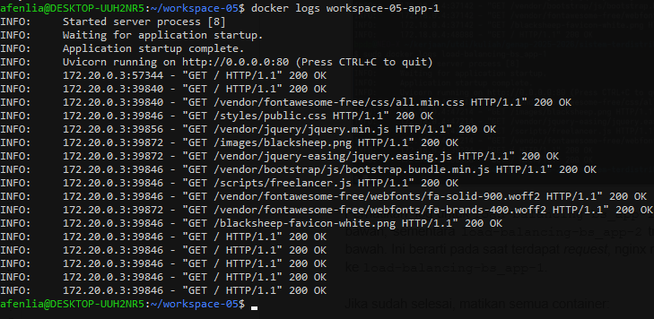
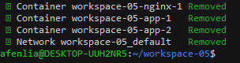
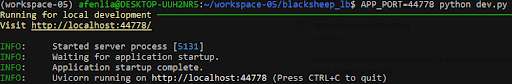
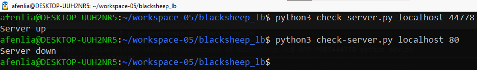
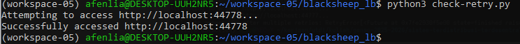
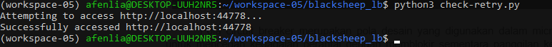
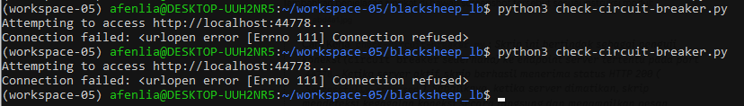

# LAPORAN PRAKTIKUM SISTEM TERDISTRIBUSI DAN TERDESENTRALISASI

## Modul 5 — Fault Tolerance: Load Balancing Aplikasi dan Failure Detection

Nama : Laesah Afenlia<br>
NIM : 255410019<br>
Kelas : IF 1<br>

---

## 1. Tujuan Praktikum

1. Memahami konsep *fault tolerance* dan *high availability* pada sistem terdistribusi.
2. Membuat aplikasi web berbasis ASGI Python menggunakan framework BlackSheep.
3. Melakukan *scaling* aplikasi menjadi lebih dari satu *instance* (2 instance) menggunakan Docker Compose.
4. Mengkonfigurasi nginx sebagai *reverse proxy* sekaligus *load balancer*.
5. Memahami dan mempraktikkan mekanisme *failure detection* menggunakan protokol *heartbeat*.
6. Memahami penerapan pola *retry* (library `tenacity`) dan pola *circuit breaker* untuk menangani kegagalan koneksi ke komponen eksternal.

---

## 2. Dasar Teori

### 2.1 Fault Tolerance
*Fault tolerance* (toleransi kesalahan) adalah kemampuan sistem untuk tetap berfungsi dengan benar meskipun sebagian komponennya mengalami kegagalan. Pada sistem terdistribusi, kegagalan adalah hal yang wajar (node mati, jaringan putus, proses *crash*), sehingga sistem harus dirancang agar kegagalan satu komponen tidak membuat seluruh layanan berhenti. Teknik yang umum digunakan antara lain replikasi (redundansi), *load balancing*, *failure detection*, *retry*, dan *circuit breaker*.

### 2.2 High Availability dan Scaling
*High availability* (HA) adalah kondisi ketika layanan tetap tersedia dalam waktu yang sangat tinggi. Salah satu cara mencapainya adalah *horizontal scaling*, yaitu menjalankan aplikasi lebih dari satu *instance*. Jika satu instance gagal, instance lain masih dapat melayani permintaan.

### 2.3 Load Balancing
*Load balancing* adalah teknik mendistribusikan permintaan (*request*) dari klien ke beberapa server/instance agar beban terbagi merata, waktu respons lebih baik, dan tidak ada *single point of failure* pada sisi aplikasi. Algoritma yang umum: *round robin*, *least connections*, dan *IP hash*. Pada nginx, algoritma bawaan untuk blok `upstream` adalah *round robin*.

### 2.4 nginx sebagai Reverse Proxy
nginx adalah web server yang juga banyak dipakai sebagai *reverse proxy* dan *load balancer*. Direktif `upstream` mendefinisikan kelompok server *backend*, sedangkan `proxy_pass` meneruskan permintaan klien ke kelompok tersebut. Klien hanya berkomunikasi dengan nginx (port 80), tanpa mengetahui ada berapa instance di belakangnya.

### 2.5 Docker dan Docker Compose
*Docker* membungkus aplikasi beserta dependensinya ke dalam *container* sehingga lingkungan eksekusi konsisten. *Docker Compose* memungkinkan pengelolaan beberapa container sekaligus melalui satu berkas `docker-compose.yml`. Opsi `--scale <service>=N` digunakan untuk menjalankan N instance dari suatu *service*. Di dalam jaringan Compose, container dapat saling menjangkau menggunakan nama *service* (misalnya `bs_app`) sebagai nama host.

### 2.6 BlackSheep
BlackSheep adalah *web framework* asinkron untuk Python yang berjalan di atas standar ASGI (dijalankan dengan server seperti Uvicorn). Pada praktikum ini BlackSheep hanya digunakan sebagai aplikasi contoh (template `mvc`) untuk keperluan pengujian *load balancing*.

### 2.7 Failure Detection
*Failure detection* adalah proses untuk menentukan apakah suatu komponen telah gagal. Deteksi yang akurat penting agar sistem dapat segera melakukan pemulihan, misalnya mengalihkan lalu lintas ke komponen lain.

### 2.8 Heartbeat
Protokol *heartbeat* memantau aktivitas suatu komponen. Jika komponen pemantau tidak menerima *heartbeat* dari komponen lain dalam jangka waktu tertentu, komponen tersebut diasumsikan telah gagal dan tidak responsif. Pada praktikum ini, pemeriksaan dilakukan dengan script `check-server.py` yang mencoba terhubung ke host dan port tertentu.

### 2.9 Retry dengan Tenacity
Koneksi ke komponen di luar aplikasi selalu berpotensi gagal (kegagalan sementara/*transient*). Pola *retry* mengulangi percobaan beberapa kali sebelum menyerah. Library `tenacity` menyediakan dekorator untuk mengatur jumlah percobaan, jeda antar percobaan (*wait*), dan kondisi berhenti (*stop*).

### 2.10 Circuit Breaker
*Circuit breaker* adalah pola desain pada *microservices* untuk mencegah kegagalan berantai (*cascading failure*) dengan memblokir sementara panggilan ke layanan yang gagal. Pola ini bekerja sebagai *state machine* dengan tiga status:

1. **Closed**: permintaan diizinkan dan dipantau kegagalannya. Jika ambang batas kegagalan terpenuhi, status beralih ke *open*.
2. **Open**: permintaan langsung ditolak agar layanan punya waktu untuk pulih. Setelah batas waktu tertentu, status beralih ke *half-open*.
3. **Half-open**: sejumlah permintaan terbatas diizinkan sebagai uji. Jika berhasil, sirkuit kembali ke *closed*; jika gagal, kembali ke *open*.

---

## 3. Langkah Kerja

### 3.1 Persiapan Environment

```bash
mkdir workspace-05
cd workspace-05
uv venv
source .venv/bin/activate
uv pip install blacksheep blacksheep-cli
```

**uv pip install blacksheep**<br>
<br>

**uv pip install blacksheep-cli**<br>
<br>

**Pembahasan:**
1. **`mkdir workspace-05 && cd workspace-05`**: Membuat direktori kerja baru bernama `workspace-05` dan berpindah ke dalamnya.
2. **`uv venv`**: Membuat *virtual environment* Python terisolasi di direktori `.venv` menggunakan `uv`.
3. **`source .venv/bin/activate`**: Mengaktifkan *virtual environment*, ditandai munculnya `(workspace-05)` pada prompt terminal.
4. **`uv pip install blacksheep blacksheep-cli`**: Menginstal framework web ASGI `blacksheep` beserta perkakas *command line* `blacksheep-cli`.

---

### 3.2 Membuat Aplikasi BlackSheep

```bash
blacksheep create
# Project name: blacksheep_lb | Template: mvc | OpenAPI: Yes
# Settings library: essentials-configuration | Format: TOML
cd blacksheep_lb
uv pip install -r requirements.txt
python dev.py
```

<br>

**Pembahasan:**
1. **`blacksheep create`**: Membuat struktur awal project secara otomatis dengan template MVC dan dokumentasi OpenAPI.
2. **`cd blacksheep_lb`**: Masuk ke direktori project yang baru dibuat.
3. **`uv pip install -r requirements.txt`**: Menginstal seluruh dependensi yang dibutuhkan aplikasi.
4. **`python dev.py`**: Menjalankan server pengembangan (Uvicorn) pada port `44777`.

Server dijalankan untuk memastikan aplikasi dapat berjalan dengan baik:<br>
<br>
<br>

**Pembahasan:**
1. Log `Uvicorn running on http://localhost:44777` menunjukkan aplikasi BlackSheep berhasil diinisialisasi dan siap diakses.
2. Server dihentikan dengan menekan `Ctrl + C` setelah pengujian selesai.

Aplikasi diakses melalui browser di `http://localhost:44777`:<br>
<br>

**Pembahasan:** Halaman utama BlackSheep (berlatar hijau) tampil dengan normal, menandakan aplikasi berjalan dengan baik.

Pada terminal tempat server dijalankan muncul log HTTP request:<br>
<br>

**Pembahasan:** Status `200 OK` pada setiap request `GET` (halaman utama dan file statis seperti CSS, JavaScript, dan gambar) menandakan server merespons dengan benar.

Pada direktori `blacksheep_lb` sudah tersedia `Dockerfile` bawaan:<br>
<br>

**Pembahasan:**
1. **`ls -la`**: Menampilkan seluruh berkas dan direktori (termasuk berkas tersembunyi) di dalam `blacksheep_lb`.
2. Template BlackSheep otomatis menyediakan `Dockerfile` dan `.dockerignore` untuk keperluan kontainerisasi.
3. `Dockerfile` bawaan menjalankan Uvicorn pada **port 80**, bukan `44777` seperti pada mode pengembangan lokal. Hal ini penting diperhatikan saat menggunakan Docker Compose.

---

### 3.3 Menyiapkan Dockerfile dan docker-compose.yml

Ada dua komponen utama: aplikasi BlackSheep yang akan di-*scale* menjadi 2 instance, dan nginx sebagai *load balancer*. Struktur direktori yang disiapkan:

```
.
├── blacksheep_lb/        # aplikasi BlackSheep (punya Dockerfile sendiri)
├── nginx/
│   ├── Dockerfile
│   └── nginx.conf
├── docker-compose.yml
└── env.sh                # alias (opsional, Linux - Bash)
```

<br>

**Pembahasan:**
1. **`cd ~/workspace-05`**: Berpindah ke direktori kerja utama.
2. **`mkdir -p nginx`**: Membuat folder `nginx` yang akan berisi konfigurasi dan Dockerfile untuk *load balancer*.
3. Di dalamnya disiapkan `nginx.conf` dan `Dockerfile`.

#### blacksheep_lb/Dockerfile

<br>

**Pembahasan:** Dockerfile menggunakan *multi-stage build* sehingga dependensi pembangunan yang besar terpisah dari image akhir.

*Stage 1 — Build (`server_builder`)*
* Menggunakan base image `python:3.14.4-slim` (satu-satunya perubahan dari Dockerfile bawaan adalah versi Python ini).
* Menginstal pustaka sistem (`build-essential`, `libssl-dev`, `sqlite3`, dll.) untuk kompilasi paket Python.
* Menyalin kode ke `/home`, membuat *virtual environment* `venv`, lalu menginstal dependensi dari `requirements.txt`.

*Stage 2 — Production (image akhir)*
* Menggunakan base image `python:3.14.4-slim` yang bersih, lalu menyalin hasil build (`/home` berisi `venv` dan kode aplikasi) dari stage `server_builder`.
* Mengatur variabel lingkungan `APP_ENV=prod` dan `BG_COLOR="#1abc9c"`.
* Menginstal pustaka runtime yang diperlukan (`sqlite3`, `libsqlite3-dev`, `libjpeg-dev`, `zlib1g-dev`).
* `CMD` mengaktifkan `venv` dan menjalankan `uvicorn "app.main:app"` pada `0.0.0.0` port **80**, sehingga aplikasi di dalam container mendengarkan pada port 80.

#### nginx/Dockerfile

```dockerfile
FROM nginx

# Override the default nginx configuration file
RUN rm /etc/nginx/conf.d/default.conf
COPY nginx.conf /etc/nginx/nginx.conf
```

<br>

**Pembahasan:**
1. `FROM nginx` memakai image resmi nginx sebagai dasar.
2. `RUN rm /etc/nginx/conf.d/default.conf` menghapus konfigurasi bawaan agar tidak bentrok.
3. `COPY nginx.conf /etc/nginx/nginx.conf` menyalin konfigurasi *load balancer* kustom ke dalam container.

#### nginx/nginx.conf

```nginx
events {
  worker_connections 4096;
}

http {
  # Definisi grup, lihat di docker-compose.yml
  upstream backend {
    server bs_app:80;
  }
  server {
    listen 80;
    location / {
      # sesuaikan dengan nama upstream di atas
      proxy_pass http://backend;
    }
  }
}
```

<br>

**Pembahasan:**
1. Blok `upstream backend` mendefinisikan grup server aplikasi. `bs_app` adalah nama *service* pada `docker-compose.yml`, yang oleh DNS internal Docker diterjemahkan ke alamat seluruh instance `bs_app`.
2. Blok `server` mendengarkan pada port 80 dan meneruskan semua permintaan (`location /`) ke grup `backend` melalui `proxy_pass http://backend;`.
3. `worker_connections 4096` menentukan jumlah koneksi maksimum per proses worker nginx.

#### docker-compose.yml

```yaml
services:
  # aplikasi yang akan di-scale, ada pada direktori blacksheep_lb
  bs_app:
    build: ./blacksheep_lb
  # nginx dibangun dari nginx/Dockerfile
  nginx:
    container_name: nginx
    build: ./nginx
    ports:
      - 80:80
    depends_on:
      - bs_app
```

<br>

**Pembahasan:**
1. **Service `bs_app`**: Dibangun dari direktori `./blacksheep_lb` dan akan di-*scale* menjadi 2 instance.
2. **Service `nginx`**: Dibangun dari `./nginx`, memetakan port 80 host ke port 80 container sehingga aplikasi diakses lewat `http://localhost`.
3. **`depends_on`**: Memastikan container `nginx` dijalankan setelah container `bs_app` dibuat dan dijalankan (opsi ini mengatur urutan start, bukan menjamin aplikasi sudah siap melayani request).

#### env.sh

```bash
alias dcu="sudo docker-compose up --build -d --scale bs_app=2"
alias dcd="sudo docker compose down"
alias dps="docker ps --format '{{.Image}} {{.Names}}'"
alias dcln="docker logs nginx"
```

<br>

**Pembahasan:**
1. Berkas `env.sh` disunting menggunakan editor Nano di terminal WSL.
2. Alias yang dibuat: `dcu` (build dan jalankan container dengan `bs_app` 2 instance), `dcd` (matikan container), `dps` (lihat image dan nama container yang berjalan), dan `dcln` (lihat log nginx).

---

### 3.4 Menjalankan Docker Compose

Jalankan dulu service Docker, lalu aktifkan alias dan jalankan Compose:

```bash
sudo systemctl start docker       # atau: sudo service docker start (WSL tanpa systemd)
source env.sh
dcu                               # build + jalankan, bs_app di-scale jadi 2
dps                               # cek container
sudo docker logs workspace-05-bs_app-1
sudo docker logs workspace-05-bs_app-2
dcd                               # matikan semua container
```

> Awalan nama container (`workspace-05-...`) berasal dari nama direktori proyek.

<br>

**Pembahasan:**
1. Log menunjukkan server Uvicorn berhasil dijalankan dan siap menerima koneksi pada port 80.
2. Log akses `GET` dengan status `200 OK` menandakan container merespons request dan memuat aset (CSS, JS, gambar) tanpa kendala.

---

## 4. Hasil dan Pembahasan

### 4.1 Load Balancing

Setelah `dcu`, Docker membangun image `bs_app` dan `nginx`, lalu menjalankan 3 container: 1 container nginx dan 2 instance `bs_app`. Aplikasi diakses melalui `http://localhost` (port 80), bukan lagi port 44777, karena klien sekarang berkomunikasi dengan nginx.

Log kedua instance diperiksa untuk memastikan distribusi request:<br>
<br>

**Pembahasan:**
1. Kedua instance (`bs_app-1` dan `bs_app-2`) berhasil dijalankan dan mendengarkan pada port 80 di dalam jaringan Docker.
2. Request `GET /` beserta aset statis tercatat pada kedua instance. Artinya nginx meneruskan request klien ke instance yang berbeda-beda, sehingga beban terdistribusi dan tidak bertumpu pada satu instance.
3. Jika salah satu instance mati, instance lainnya tetap dapat melayani request sehingga *availability* aplikasi meningkat.

### 4.2 Heartbeat (`check-server.py`)

Server BlackSheep dijalankan lebih dahulu pada port 44777:<br>
<br>

Script `check-server.py` dijalankan:<br>
<br>

Pada kondisi BlackSheep aktif di port 44777, perintah `python check-server.py localhost 44777` menampilkan `Server up`. Pada kondisi tidak ada server di port 80, perintah `python check-server.py localhost 80` menampilkan `Server down`.

**Pembahasan:** Script mencoba terhubung ke host dan port yang diberikan. Jika koneksi berhasil, komponen dianggap hidup (*up*); jika koneksi gagal atau ditolak, komponen dianggap gagal (*down*). Inilah prinsip dasar *failure detection*: respons dari komponen menjadi tanda ia masih aktif, sedangkan ketiadaan respons dianggap sebagai kegagalan.

### 4.3 Retry dengan Tenacity (`check-retry.py`)

<br>
<br>

Pada kondisi BlackSheep aktif, muncul pesan `Attempting to access http://localhost:44777...` lalu `Successfully accessed http://localhost:44777`, artinya akses berhasil pada percobaan pertama.

Pada kondisi BlackSheep non-aktif, pesan `Attempting to access ...` muncul 5 kali, lalu diakhiri dengan `Failed to access URL after multiple retries: RetryError[... raised ConnectionError]`.

**Pembahasan:** Saat server aktif, koneksi langsung berhasil sehingga tidak ada pengulangan. Saat server mati, `tenacity` mengulangi percobaan beberapa kali (terlihat dari pesan *Attempting* yang berulang). Setelah semua percobaan habis, muncul `RetryError` dengan penyebab `ConnectionError`. Pola *retry* cocok untuk kegagalan sementara, misalnya server yang baru saja restart. Kekurangannya, jika layanan benar-benar mati, pengulangan hanya membuang waktu dan sumber daya.

### 4.4 Circuit Breaker (`check-circuit-breaker.py`)

<br>

Pada kondisi BlackSheep aktif, muncul pesan `Attempting to access http://localhost:44777...` lalu `Successfully accessed http://localhost:44777`.

Pada kondisi BlackSheep non-aktif, muncul pesan error `HTTPConnectionPool(host='localhost', port=44777): Max retries exceeded ... [Errno 111] Connection refused`.

**Pembahasan:**
1. Script mencoba mengakses endpoint server pada port 44777. Saat server aktif, request berhasil dan script mencetak `Successfully accessed`.
2. Saat server dimatikan, koneksi ditolak (`Connection refused`, Errno 111). Kegagalan ini ditangkap dan dilaporkan lewat pesan error tanpa membuat program utama *crash*.
3. Secara konsep, *circuit breaker* menghitung kegagalan. Selama kegagalan di bawah ambang batas, sirkuit tetap *closed* dan request diteruskan. Setelah ambang batas terpenuhi, sirkuit menjadi *open* dan request berikutnya langsung ditolak tanpa menghubungi layanan yang gagal. Setelah waktu pemulihan, sirkuit menjadi *half-open* untuk menguji apakah layanan sudah pulih. Nilai ambang batas dan waktu pemulihan mengikuti pengaturan pada script.

### 4.5 Perbandingan Retry dan Circuit Breaker

*Retry* bertujuan mengatasi kegagalan sementara. Saat terjadi kegagalan, ia mengulang percobaan beberapa kali. Risikonya, pengulangan bisa membebani layanan yang sedang bermasalah, sehingga paling cocok untuk gangguan singkat.

*Circuit breaker* bertujuan mencegah kegagalan berantai dan melindungi layanan. Saat terjadi kegagalan, ia memblokir panggilan untuk sementara. Risikonya, request bisa ditolak walaupun layanan sebenarnya sudah pulih (sebelum masuk status *half-open*), sehingga paling cocok untuk layanan yang gagal berkepanjangan.

Keduanya saling melengkapi dan sering digunakan bersamaan.

---

## 5. Kesimpulan

1. *Load balancing* dengan nginx dan Docker Compose berhasil mendistribusikan permintaan ke 2 instance aplikasi BlackSheep sehingga meningkatkan *high availability*.
2. Protokol *heartbeat* sederhana mampu membedakan kondisi server aktif (`Server up`) dan tidak aktif (`Server down`).
3. Pola *retry* (`tenacity`) menangani kegagalan sementara dengan mengulang percobaan, dan melaporkan `RetryError` bila semua percobaan gagal.
4. Pola *circuit breaker* mencegah kegagalan berantai dengan membatasi panggilan ke layanan yang gagal, melalui tiga status *closed*, *open*, dan *half-open*.
5. Kombinasi *load balancing*, *failure detection*, *retry*, dan *circuit breaker* menjadi fondasi penting untuk membangun sistem terdistribusi yang toleran terhadap kegagalan.
