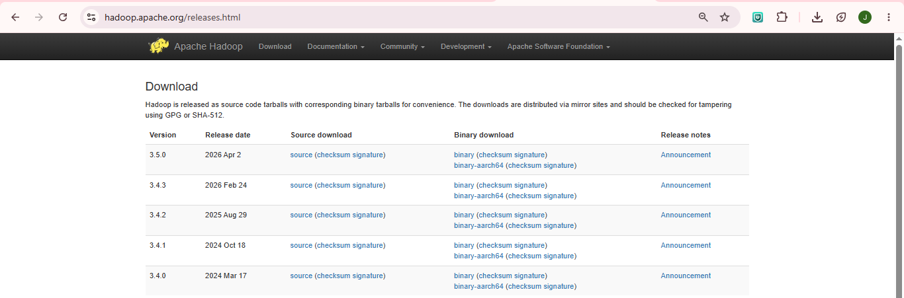
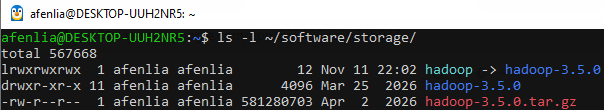
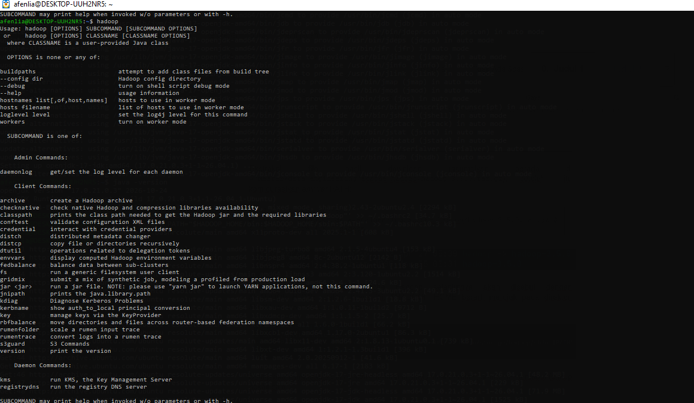

# Modul 6 - Distributed File System (HDFS)

Nama : Laesah Afenlia<br>
NIM : 255410019<br>
Kelas : IF 1<br>

## 0. Persyaratan Software

- **JDK 17 dan/atau 21**. Jika akan mengkompilasi Apache Hadoop, gunakan JDK 17. JDK 17 dipakai untuk server, sedangkan client bisa memakai JDK 17 atau 21.
- **Apache Hadoop 3.5.0**
- **pdsh**
- **ssh**
- **sshd** sudah berjalan:
  - Artix Linux + dinit: `sudo dinitctl start sshd`
  - systemd: `sudo systemctl start ssh`

## 1. Unduh Apache Hadoop

Ambil distribusi Apache Hadoop di <https://hadoop.apache.org/releases.html> (pilih versi 3.5.0, binary).

<br>

## 2. Instalasi Apache Hadoop

<br

<br>
<br>

Ekstrak file hasil download (asumsi berada di `~/master/data-engineering/apache-hadoop/hadoop-3.5.0.tar.gz`), lalu buat symlink:

```bash
cd ~/software/storage/
tar -xvf ~/master/data-engineering/apache-hadoop/hadoop-3.5.0.tar.gz
ln -s hadoop-3.5.0 hadoop
```

Lokasi instalasi selanjutnya disebut `$HADOOP_HOME`, yaitu `$HOME/software/storage/hadoop`.

Buat file env `~/env/bash/storage/hadoop.sh` berisi:

```bash
export PATH="$HOME/software/storage/hadoop/bin:$HOME/software/storage/hadoop/sbin:$PATH"
```

Setiap akan memakai Hadoop di sebuah shell/terminal, jalankan (cukup sekali per shell):

```bash
source ~/env/bash/storage/hadoop.sh
```

Cek instalasi:

```bash
hadoop
```

Jika berhasil, akan tampil usage Hadoop beserta daftar subcommand.

## 3. Instalasi pdsh

Kebanyakan distro Linux sudah menyediakan paket `pdsh`. Pada Artix Linux, pdsh dikompilasi dari AUR menggunakan `trizen`:

<br>

```bash
trizen -Ss pdsh
trizen -S pdsh
```

Untuk distro lain, sesuaikan dengan package manager yang digunakan.

Cek pdsh:

```bash
pdsh -q -w localhost
```

Jika `Rcmd type` bukan `ssh`, atur env variable (misal di Bash):

```bash
export PDSH_RCMD_TYPE=ssh
```

Atur agar ssh ke localhost tidak perlu login (passwordless):

```bash
ssh-keygen -t rsa -P '' -f ~/.ssh/id_rsa
cat ~/.ssh/id_rsa.pub >> ~/.ssh/authorized_keys
chmod 0600 ~/.ssh/authorized_keys
```

Uji dengan `ssh localhost` (jawab `yes` saat pertama kali), lalu `logout`. Pada percobaan berikutnya tidak boleh meminta password.

## 4. Konfigurasi Apache Hadoop

Semua file berada di `$HADOOP_HOME/etc/hadoop/`.

### hdfs-site.xml

```xml
<configuration>
    <property>
        <name>dfs.replication</name>
        <value>1</value>
    </property>
</configuration>
```

### core-site.xml

Ganti `yourusername` dengan nama user Linux Anda.

```xml
<configuration>
    <property>
        <name>fs.defaultFS</name>
        <value>hdfs://localhost:9000</value>
    </property>
    <property>
        <name>hadoop.proxyuser.yourusername.groups</name>
        <value>*</value>
    </property>
    <property>
        <name>hadoop.proxyuser.yourusername.hosts</name>
        <value>*</value>
    </property>
</configuration>
```

### mapred-site.xml

```xml
<configuration>
    <property>
        <name>mapreduce.framework.name</name>
        <value>yarn</value>
    </property>
    <property>
        <name>mapreduce.application.classpath</name>
        <value>$HADOOP_CLASSPATH:$HADOOP_HOME/share/hadoop/mapreduce/*:$HADOOP_MAPRED_HOME/share/hadoop/mapreduce/lib/*</value>
    </property>
</configuration>
```

### yarn-site.xml

```xml
<configuration>
    <!-- Site specific YARN configuration properties -->
    <property>
        <name>yarn.nodemanager.aux-services</name>
        <value>mapreduce_shuffle</value>
    </property>
    <property>
        <name>yarn.nodemanager.env-whitelist</name>
        <value>JAVA_HOME,HADOOP_COMMON_HOME,HADOOP_HDFS_HOME,HADOOP_CONF_DIR,CLASSPATH_PREPEND_DISTCACHE,HADOOP_YARN_HOME,HADOOP_HOME,PATH,LANG,TZ,HADOOP_MAPRED_HOME</value>
    </property>
    <property>
        <name>yarn.nodemanager.resource.memory-mb</name>
        <value>4096</value>
    </property>
    <property>
        <name>yarn.scheduler.minimum-allocation-mb</name>
        <value>2048</value>
    </property>
    <property>
        <name>yarn.nodemanager.vmem-pmem-ratio</name>
        <value>2.1</value>
    </property>
</configuration>
```

## 5. Format NameNode

> **Peringatan:** proses ini dilakukan **sekali saja**. Jika diulang, berbagai file yang telah diproses di HDFS akan terhapus.

```bash
java -version
hdfs namenode -format
```

## 6. Atur JAVA_HOME

Edit `$HADOOP_HOME/etc/hadoop/hadoop-env.sh` dan isi `JAVA_HOME` sesuai lokasi JDK di komputer/server/node Anda, contoh:

```bash
export JAVA_HOME=/home/bpdp/.sdkman/candidates/java/current
```

## 7. Jalankan Daemon HDFS

```bash
start-dfs.sh
```

Output yang diharapkan:

```
Starting namenodes on [localhost]
Starting datanodes
Starting secondary namenodes [NEO-X]
```

Pemantauan dapat dilakukan melalui web UI NameNode: <http://localhost:9870> (pada modul, tampilan dibuka melalui `http://localhost:9870/dfshealth.html#tab-overview`).

## 8. Selesai

Jika sampai tahap ini berhasil, Hadoop dan HDFS siap digunakan. Contoh operasi file pada HDFS:

```bash
hdfs dfs -ls /
hdfs dfs -mkdir -p /user/bpdp
hdfs dfs -ls /
hdfs dfs -ls /user
```

Daftar lengkap perintah HDFS: <https://hadoop.apache.org/docs/current/hadoop-project-dist/hadoop-common/FileSystemShell.html>

Untuk menghentikan HDFS:

```bash
stop-dfs.sh
```

---

## Tugas

1. Buat direktori `/user/<nama-user>/datasets` di HDFS Anda.
2. Cari 3 file `.csv` di Internet, lalu salin ketiganya ke direktori yang baru dibuat pada tugas 1.

### Contoh penyelesaian

```bash
# 1. Buat direktori datasets di HDFS
hdfs dfs -mkdir -p /user/$(whoami)/datasets

# 2. Unduh 3 file CSV (ganti URL dengan dataset pilihan Anda)
wget -O data1.csv "<URL_CSV_1>"
wget -O data2.csv "<URL_CSV_2>"
wget -O data3.csv "<URL_CSV_3>"

# 3. Salin ke HDFS
hdfs dfs -put data1.csv data2.csv data3.csv /user/$(whoami)/datasets/

# 4. Verifikasi
hdfs dfs -ls /user/$(whoami)/datasets
```

---

## Catatan

- Port web UI NameNode pada Hadoop 3.x secara default adalah **9870**. Pada tangkapan layar modul terlihat `localhost:9870`; jika halaman tidak terbuka, cek port melalui konfigurasi `dfs.namenode.http-address`.
- Pastikan `sshd` aktif sebelum menjalankan `start-dfs.sh`, dan `JAVA_HOME` sudah diatur di `hadoop-env.sh`.
