# Modul 7 - Cloud Computing
---
Nama    : Laesah Afenlia
Nim     : 255410019 
Prodi   : IF 1

---

## 0. Pengantar

Cloud Computing menggunakan pendekatan XaaS atau sering juga disebut sebagai Everything as a Service. Dengan menggunakan pendekatan ini, provider dari Cloud Computing menyediakan berbagai sumber daya komputasi dan konsumen mendapatkan sumber daya tersebut dalam bentuk layanan. Secara umum XaaS dibagi menjadi 3:

1. SaaS: Software as a Service
2. PaaS: Platform as a Service
3. IaaS: Infrastructure as a Service

### Tugas 0

**1. Contoh vendor/komunitas SaaS, PaaS, dan IaaS**

| Kategori | Vendor |
|----------|--------|
| SaaS | Google Workspace |
| PaaS | Heroku |
| IaaS | Amazon Web Services (AWS) EC2 |

**2. Service dari masing-masing vendor**

- **SaaS - Google Workspace**: menyediakan aplikasi siap pakai seperti Gmail, Google Docs, Google Sheets, Google Drive, dan Google Meet yang diakses melalui browser. Pengguna tidak perlu mengurus server, sistem operasi, maupun instalasi aplikasi.
- **PaaS - Heroku**: menyediakan platform untuk deploy dan menjalankan aplikasi (runtime Python, Node.js, dan lainnya, add-on database, scaling, serta logging). Developer cukup mengurus kode aplikasi dan data, sedangkan sistem operasi, server, dan jaringan dikelola oleh provider.
- **IaaS - AWS EC2**: menyediakan infrastruktur virtual berupa virtual machine, storage, dan jaringan. Pengguna bebas memilih sistem operasi, menginstal software, dan mengatur konfigurasi sendiri, sedangkan perangkat keras fisik dan virtualisasi dikelola oleh provider.

**3. Arsitektur umum XaaS**

Arsitektur XaaS tersusun berlapis. Lapisan paling bawah adalah infrastruktur fisik milik provider (server, data center, virtualisasi). Di atasnya terdapat IaaS (virtual machine, storage, jaringan), kemudian PaaS (runtime, middleware, database), dan paling atas SaaS (aplikasi yang langsung dipakai pengguna). Semakin tinggi lapisannya, semakin banyak bagian yang dikelola oleh provider.

| Lapisan | IaaS | PaaS | SaaS |
|---------|------|------|------|
| Aplikasi | Pengguna | Pengguna | Provider |
| Data | Pengguna | Pengguna | Provider |
| Runtime | Pengguna | Provider | Provider |
| Middleware | Pengguna | Provider | Provider |
| Sistem Operasi | Pengguna | Provider | Provider |
| Virtualisasi | Provider | Provider | Provider |
| Server dan Storage | Provider | Provider | Provider |
| Jaringan | Provider | Provider | Provider |

### Containerized App

Salah satu hal yang membentuk layanan-layanan tersebut adalah Containerized App (CA). CA merupakan aplikasi yang dimaksudkan untuk dijalankan oleh container (docker, podman, dan lainnya). Pada praktikum ini, aplikasi blog dari tutorial Flask akan dibangun menjadi CA.

- Tutorial Flask: https://flask.palletsprojects.com/en/stable/tutorial/
- Source code: https://github.com/pallets/flask/tree/3.1.3/examples/tutorial

Jika menggunakan git, asumsikan direktori kerja ada di `$HOME/src`:

```bash
cd $HOME/src
git clone https://github.com/pallets/flask
```

Source code berada di `examples/tutorial`. Copy direktori tutorial tersebut ke direktori tertentu:

```bash
cp -R ~/src/flask/examples/tutorial flask-app
```

Kemudian masuk ke direktori baru tersebut:

```bash
cd flask-app
```

---

## 1. Membuat env Python 3.14.4 

Catatan penggunaan uv bisa diakses di https://github.com/NEO-X-School/notes/tree/main/uv

Buat env untuk keperluan mata kuliah pertemuan ini menggunakan Python versi 3.14.4:

```bash
uv python pin 3.14.4
uv venv
source .venv/bin/activate
```
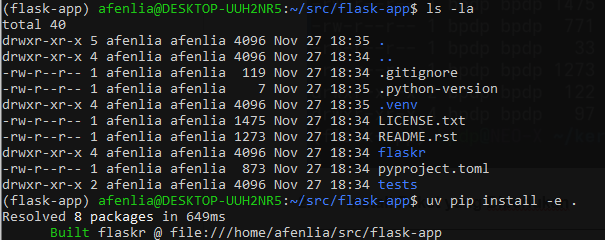<br>
---

## 2. Install Paket yang Diperlukan

```bash
uv pip install -e .
```

Paket yang terinstall: blinker, click, flask, flaskr, itsdangerous, jinja2, markupsafe, werkzeug.

Jalankan aplikasi setelah inisialisasi database:

```bash
flask --app flaskr init-db
flask --app flaskr run
```
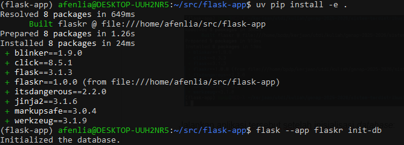<br>

Aplikasi dapat dilihat di browser melalui http://localhost:5000. Untuk mencoba, pilih "Register" kemudian "Log In".

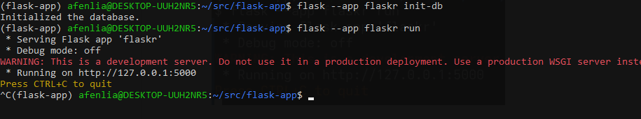<br>

Kita bisa melihat aplikasi berjalan di browser: 

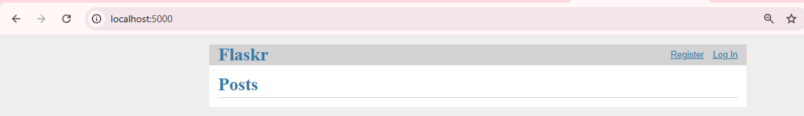<br>

Untuk mencoba, pilih “Register” kemudian “Log In” 
---

## 3. Buat Aplikasi Menjadi CA - Docker

Buat file untuk build docker bernama `Dockerfile` di direktori root dari aplikasi:
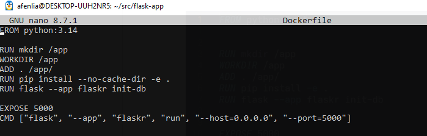<br>
Format teks: 

```dockerfile
FROM python:3.
RUN mkdir /app
WORKDIR /app
ADD . /app/
RUN pip install -e .
RUN flask --app flaskr init-db

EXPOSE 5000
CMD ["flask", "--app", "flaskr", "run", "--host=0.0.0.0", "--port=5000"]
```
Sebelum mengerjakan perintah docker, dockerd harus diaktifkan terlebih dahulu.
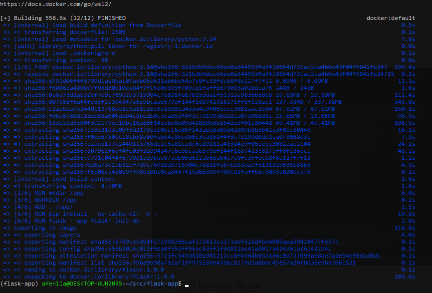<br>
Pada sistem berbasis systemd (Ubuntu, Fedora, AlmaLinux, Kali Linux, dll):

```bash
sudo systemctl start docker
```

Pada sistem berbasis dinit (Artix Linux, Chimera Linux):

```bash
sudo dinitctl start dockerd
```

Buat image dengan perintah berikut (jangan lupa ada titik di paling belakang):

```bash
sudo docker build -f Dockerfile -t flaskr:1.0.0 .
```

Cek image yang telah berhasil dibuat:

```bash
sudo docker image ls
```

Catatan: jika ada banyak image container di node anda, hapus yang tidak digunakan lagi dengan mengacu pada ID dari image tersebut:

```bash
sudo docker rmi <IMAGE_ID>
```

---

## 4. Menjalankan Image

Jalankan dengan memetakan port 5000 pada aplikasi di container ke port 5001 di localhost:
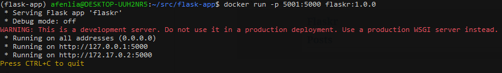<br>
Akses melalui web browser di http://localhost:5001.
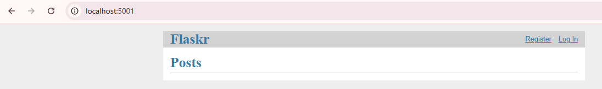<br>
Pada posisi ini, CA telah berhasil dijalankan.

---

## 4. Buat Aplikasi Menjadi CA - Podman
Jika menggunakan Podman, maka dockerd tidak perlu diaktifkan. Jika dockerd aktif, matikan service-nya.

Pada sistem berbasis dinit:

```bash
sudo dinitctl stop dockerd
```

Podman tetap bisa memanfaatkan file Dockerfile sehingga kita tetap menggunakan Dockerfile yang telah dibuat. Buat image dengan perintah berikut (perhatikan ada titik di belakang, artinya current directory):

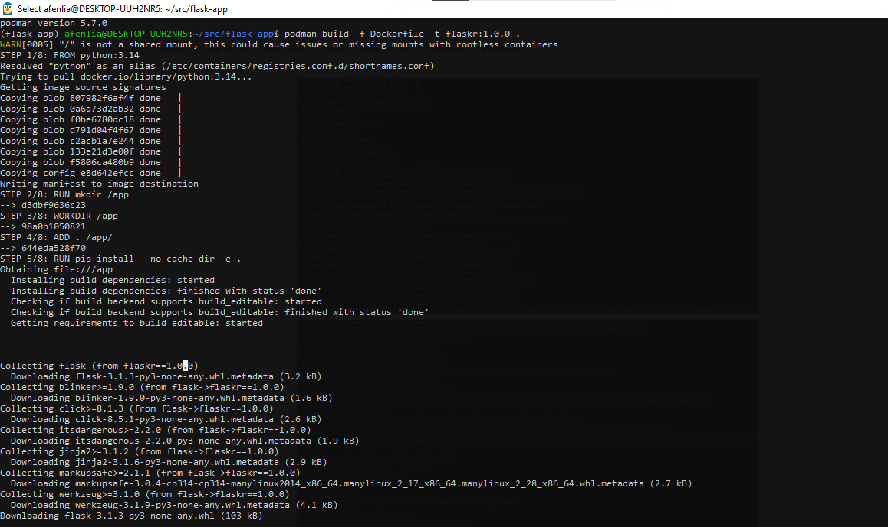<br>
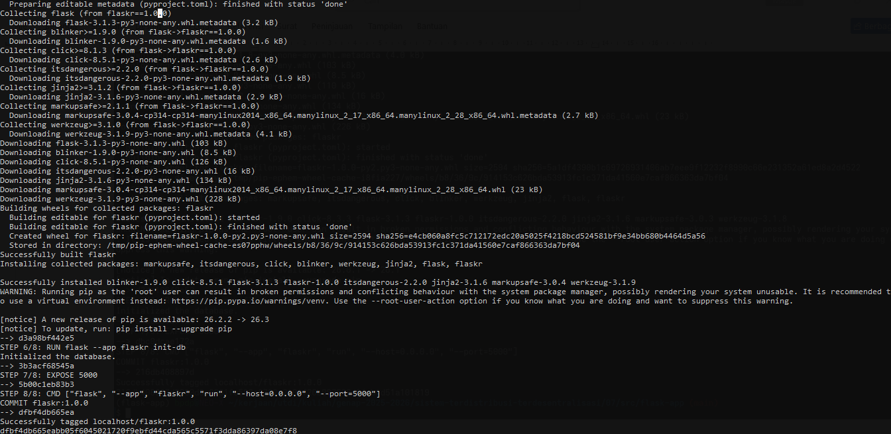<br>

Cek image yang telah berhasil dibuat:<br>

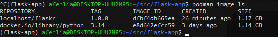<br>


Jalankan dengan memetakan port 5000 pada aplikasi di container ke port 5001 di localhost:
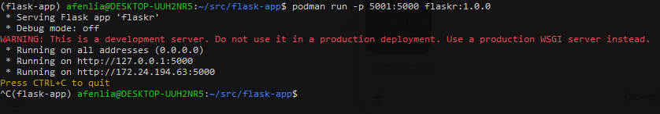<br>
Akses melalui web browser di http://127.0.0.1:5001. Pada posisi ini, CA telah berhasil dijalankan menggunakan Podman.
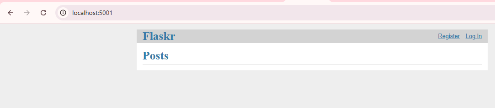<br>

---